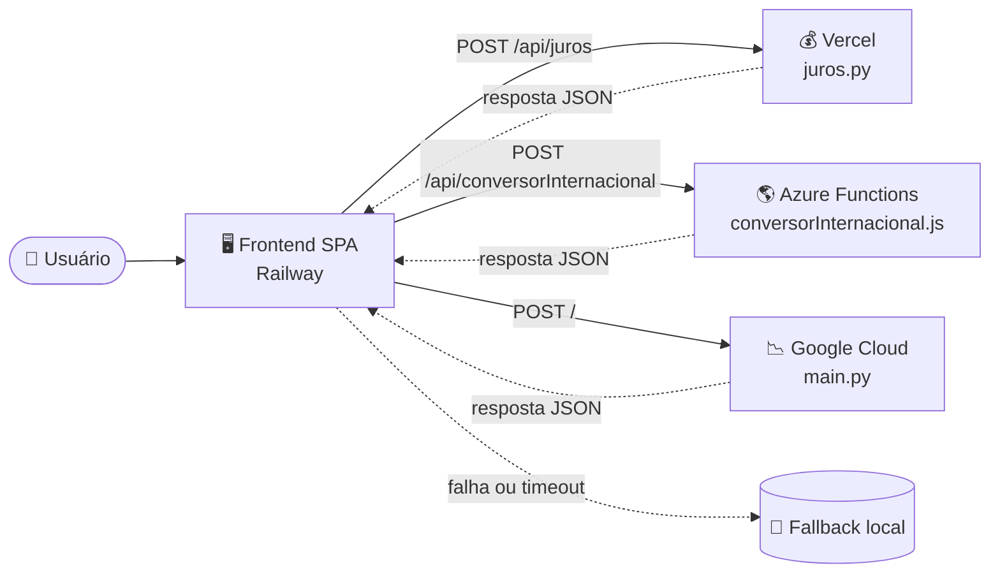

<div align="center">

# 📈 IHMInvest

**Projeção de investimentos em uma arquitetura Serverless Multicloud**

Uma SPA que simula juros compostos, converte o resultado para dólar e euro e corrige o valor pela inflação — cada cálculo rodando em um provedor de nuvem diferente.


<br>


### 🔗 [**Acessar a aplicação**](https://ihminvest-production-dashboard.up.railway.app)

</div>

---

## 📑 Sumário

- [Visão geral](#-visão-geral)
- [Arquitetura](#️-arquitetura)
- [Estrutura do repositório](#-estrutura-do-repositório)
- [Endpoints em produção](#-endpoints-em-produção)
- [Contratos HTTP](#-contratos-http)
- [Resiliência e fallback](#️-resiliência-e-fallback)
- [Como executar localmente](#-como-executar-localmente)
- [Deploy](#-deploy)
- [Testando com cURL](#-testando-com-curl)
- [Solução de problemas](#-solução-de-problemas)

---

## 💡 Visão geral

O usuário informa **aporte inicial**, **aporte mensal**, **taxa de juros anual** e **prazo**. O frontend dispara três requisições em paralelo, uma para cada nuvem, e consolida os resultados em um painel com gráfico de evolução patrimonial:

| Módulo | Provedor | Linguagem | O que calcula |
|---|---|---|---|
| 💰 **Juros compostos** | Vercel Functions *(substituindo a AWS Lambda)* | Python | Saldo final, total investido e rendimento |
| 🌎 **Conversão de moedas** | Azure Functions | Node.js | Saldo final em USD e EUR |
| 📉 **Ajuste de inflação** | Google Cloud (Cloud Run Functions) | Python | Valor real do saldo descontando o IPCA estimado |
| 🖥️ **Frontend** | Railway | HTML + JS puro | Interface, gráfico e orquestração das chamadas |

---

## 🏗️ Arquitetura



As três chamadas são **independentes** (`Promise.all`): a lentidão ou queda de um provedor não bloqueia os outros.

---

## 📁 Estrutura do repositório

```
Saasmulticloud/
├── api/
│   └── juros.py                    # Função Vercel (Python) — juros compostos
├── azure-functions/
│   ├── src/functions/
│   │   └── conversorInternacional.js  # Função Azure (Node.js) — conversão de moedas
│   ├── host.json
│   └── package.json
├── google-functions/
│   ├── main.py                     # Função GCP (Python) — ajuste de inflação
│   └── requirements.txt
├── frontend-app/
│   ├── index.html                  # SPA: interface, gráfico, chamadas HTTP e fallback
│   └── package.json                # Script de start para o Railway (serve)
├── vercel.json                     # Configuração do projeto Vercel
├── Atividade 04 - Ecossistema SaaS Multicloud Integrado.pdf   # Enunciado da atividade
└── Documentacao_Tecnica_IHMInvest_Multicloud.docx            # Documentação técnica
```

---

## 🌐 Endpoints em produção

Configurados no objeto `API_ENDPOINTS` de `frontend-app/index.html`:

| Provedor | URL |
|---|---|
| Frontend (Railway) | [`https://ihminvest-production-dashboard.up.railway.app`](https://ihminvest-production-dashboard.up.railway.app) |
| Vercel | `https://saasmulticloud-juros-functions.vercel.app/api/juros` |
| Azure | `https://conversorinternacional-ckfhcba3axdjc0cw.northcentralus-01.azurewebsites.net/api/conversorInternacional` |
| Google Cloud | `https://projetor-inflacao-bnizxb6syq-rj.a.run.app` |

---

## 🔌 Contratos HTTP

Todas as funções recebem `POST` com `Content-Type: application/json` e respondem JSON.

### 💰 Vercel — Juros compostos

A taxa anual é convertida em taxa mensal equivalente: `(1 + taxa_anual)^(1/12) − 1`.

| Campo de entrada | Tipo | Descrição |
|---|---|---|
| `initial` | número | Aporte inicial (≥ 0) |
| `monthly` | número | Aporte mensal (≥ 0) |
| `annualRate` | número | Taxa anual em decimal (`0.1` = 10% a.a.) |
| `months` | inteiro | Prazo em meses (≥ 1) |

```jsonc
// Requisição
{ "initial": 1000, "monthly": 100, "annualRate": 0.1, "months": 12 }

// Resposta 200
{ "balance": 2354.05, "invested": 2200.0, "profit": 154.05 }
```

### 🌎 Azure — Conversão de moedas

As cotações são **demonstrativas** (não consultam o mercado). Se omitidas, a função usa USD = 5,00 e EUR = 6,25.

| Campo de entrada | Tipo | Descrição |
|---|---|---|
| `valorReais` | número | Valor em reais (≥ 0) |
| `cotacaoDolar` | número *(opcional)* | Cotação do dólar (> 0) |
| `cotacaoEuro` | número *(opcional)* | Cotação do euro (> 0) |

```jsonc
// Requisição
{ "valorReais": 2354.05, "cotacaoDolar": 5.5, "cotacaoEuro": 6.0 }

// Resposta 200
{
  "provedor": "Azure",
  "valorReais": 2354.05,
  "valorDolar": 428.01,
  "valorEuro": 392.34,
  "cotacaoDolar": 5.5,
  "cotacaoEuro": 6.0,
  "cotacaoSimulada": true
}
```

### 📉 Google Cloud — Ajuste de inflação

Calcula o valor real: `balance / (1 + inflation)^(months / 12)`.

| Campo de entrada | Tipo | Descrição |
|---|---|---|
| `balance` | número | Saldo nominal (≥ 0) |
| `inflation` | número | Inflação anual em decimal (> −1) |
| `months` | número | Prazo em meses (0 a 360) |

```jsonc
// Requisição
{ "balance": 2354.05, "inflation": 0.045, "months": 12 }

// Resposta 200
{ "real": 2252.68 }
```

> ℹ️ A inflação é injetada pelo frontend através da constante `ESTIMATED_INFLATION_RATE` (**4,5% a.a.**), e as cotações de USD/EUR enviadas à Azure são fixas em **R$ 5,50** e **R$ 6,00**.

### ⚠️ Respostas de erro

| Status | Quando |
|---|---|
| `400` | JSON inválido, campo ausente ou valor fora dos limites |
| `405` | Método diferente de `POST` (GCP) |
| `500` | Erro interno inesperado |

---

## 🛡️ Resiliência e fallback

- As requisições têm **timeout de 8 segundos** (`REQUEST_TIMEOUT_MS`).
- Cada card mostra o **provedor**, o **status** da chamada e a **latência real**.
- O frontend **valida** cada resposta: campo ausente ou não numérico é tratado como falha.
- Em caso de erro de rede, timeout, status HTTP ≠ 2xx ou resposta inválida, o módulo usa o **cálculo local** (mesmas fórmulas, em JavaScript) e avisa que o serviço está indisponível — a interface nunca fica quebrada.

---

## 💻 Como executar localmente

### Frontend

```bash
cd frontend-app
npx serve . -l 3000
# ou abra o index.html com a extensão Live Server do VS Code
```

### Função Vercel (juros)

```bash
npm i -g vercel
vercel dev          # na raiz do repositório
# disponível em http://localhost:3000/api/juros
```

### Função Azure (conversão)

Requer o [Azure Functions Core Tools](https://learn.microsoft.com/azure/azure-functions/functions-run-local) v4.

```bash
cd azure-functions
npm install
npm start           # func start → http://localhost:7071/api/conversorInternacional
```

### Função Google Cloud (inflação)

```bash
cd google-functions
pip install -r requirements.txt
functions-framework --target=projetor_inflacao --port=8080
```

> Para testar o frontend contra as funções locais, troque as URLs em `API_ENDPOINTS` no `index.html`.

> ⚠️ O CORS da Azure em produção libera **apenas** a origem `https://ihminvest-production-dashboard.up.railway.app`. Rodando o frontend em `localhost`, o card da Azure vai cair no fallback local, a menos que a origem local seja adicionada no portal da Azure.

---

## 🚀 Deploy

| Provedor | Como publicar |
|---|---|
| **Vercel** | `vercel --prod` na raiz, ou push no `main` se o projeto estiver conectado ao GitHub. A pasta `api/` é detectada automaticamente. |
| **Azure** | `func azure functionapp publish <nome-do-app>` dentro de `azure-functions/`, ou pela extensão Azure Functions do VS Code. O CORS é configurado no portal (o código não envia cabeçalhos CORS). |
| **Google Cloud** | `gcloud functions deploy` com `--source=google-functions`, `--entry-point=projetor_inflacao`, `--trigger-http` e `--allow-unauthenticated`. A função já trata o preflight `OPTIONS` no próprio código. |
| **Railway** | Aponte o serviço para a pasta `frontend-app/`; o script `start` sobe o `serve` na porta `$PORT`. |

---

## 🧪 Testando com cURL

```bash
# Preflight CORS (deve responder 204 com Access-Control-Allow-Origin: *)
curl -i -X OPTIONS https://saasmulticloud-juros-functions.vercel.app/api/juros \
  -H "Origin: http://localhost" -H "Access-Control-Request-Method: POST"

# Cálculo de juros
curl -X POST https://saasmulticloud-juros-functions.vercel.app/api/juros \
  -H "Content-Type: application/json" \
  -d '{"initial":1000,"monthly":100,"annualRate":0.1,"months":12}'
```

---

## 🩺 Solução de problemas

| Sintoma | Causa provável | Solução |
|---|---|---|
| Erro de **CORS** só no card da Azure, rodando local | A Azure só libera a origem do Railway | Adicione a origem local no CORS do portal da Azure ou teste pela URL do Railway |
| Erro de **CORS** no console | O preflight `OPTIONS` não respondeu 2xx (função sem tratamento de `OPTIONS`) **ou** a URL não existe (`404 DEPLOYMENT_NOT_FOUND`) | Teste o endpoint com cURL; confira a URL em `API_ENDPOINTS` e se a versão publicada trata `OPTIONS` |
| Card mostra "fallback local" | Timeout, erro de rede ou resposta fora do contrato | Veja a mensagem em `console.error` e teste o endpoint isoladamente |
| `HTTP 400` | Campo ausente ou fora dos limites | Confira o contrato do provedor acima |

---

<div align="center">

📚 Projeto acadêmico — **Atividade 04: Ecossistema SaaS Multicloud Integrado**

<sub>As projeções exibidas são estimativas matemáticas para fins acadêmicos e não constituem recomendação financeira.</sub>

</div>
